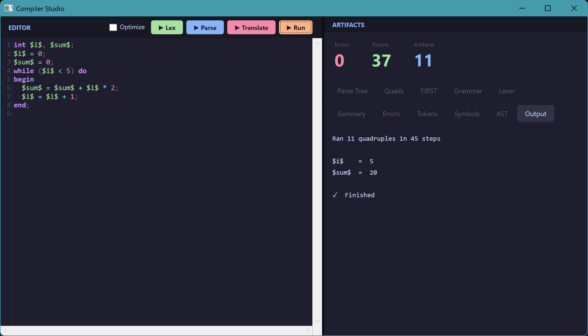
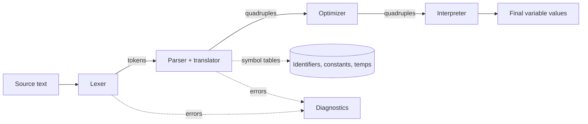

# Compiler Studio

[](https://github.com/Salmalamnabhi/CompilerStudio/actions/workflows/ci.yml)

A complete compiler for a small imperative language, written in C# / .NET 8.
It goes from source text to optimized three-address code and runs the result,
with a WPF desktop app that shows every stage and a command-line tool for scripting.

**[Download the latest release](https://github.com/Salmalamnabhi/CompilerStudio/releases/latest)**:
single-file Windows executables for the desktop app and the CLI, no .NET install needed.



## Features

- **Hand-written lexer** with line/column tracking and clear error messages
- **Recursive-descent LL(1) parser** that logs every grammar production it applies
- **Syntax-directed translation** to quadruples `(op, arg1, arg2, result)`, with
  backpatching for `if`/`else` and `while`
- **Semantic checks**: declarations, type conflicts, use before assignment
- **Optimizer**: constant folding and propagation, dead-temp removal, copy merging,
  unreachable-code and redundant-jump removal
- **Interpreter** that executes the quadruples, with a step limit to catch infinite loops
- **Desktop app** (WPF + AvalonEdit) with syntax highlighting and views for tokens,
  parse log, quadruples, symbol tables, errors and program output
- **`cstudio` CLI** with gcc-style diagnostics and meaningful exit codes
- **77 passing xUnit tests**, including golden tests for generated code and a check that
  optimized and unoptimized programs always produce the same results

## How it works



Tokens are produced on demand, so lexical, syntax and semantic errors are reported
in source order. The optimizer is optional: without it, the translator's output
runs unchanged.

| Stage | File |
|---|---|
| Lexer | [`Lexer.cs`](src/CompilerStudio.Core/Lexer.cs) |
| Parser (syntax check only) | [`Parser.cs`](src/CompilerStudio.Core/Parser.cs) |
| Translator (semantics + code generation) | [`Translator.cs`](src/CompilerStudio.Core/Translator.cs) |
| Optimizer | [`Optimizer.cs`](src/CompilerStudio.Core/Optimizer.cs) |
| Interpreter | [`Interpreter.cs`](src/CompilerStudio.Core/Interpreter.cs) |
| Entry points | [`Compiler.cs`](src/CompilerStudio.Core/Compiler.cs) |

## The language

Variables are written between dollar signs (`$name$`) and are all `int`.
A program is one declaration followed by statements, each ending in `;`.

```
int $i$, $sum$;
$i$ = 0;
$sum$ = 0;
while ($i$ < 5) do
begin
  $sum$ = $sum$ + $i$ * 2;
  $i$ = $i$ + 1;
end;
```

### Grammar

```
program    → var_decl ";" stmts
var_decl   → "int" id { "," id }
stmts      → stmt ";" { stmt ";" }
stmt       → assign | if_stmt | while_stmt
assign     → id ( "=" | ":=" ) expr
if_stmt    → "if" "(" cond ")" "then" nested ";" "else" nested
while_stmt → "while" "(" cond ")" "do" nested
nested     → stmt | "begin" stmts "end"
cond       → expr relop expr
expr       → term { "+" term }
term       → factor { "*" factor }
factor     → id | number | "(" expr ")"
relop      → "<" | "<=" | ">" | ">=" | "==" | "!="
```

## Example: what the optimizer does

The loop above compiles to 11 quadruples. With `--optimize`, the temps that only
carry a value into an assignment are merged away, leaving 9:

<table>
<tr><th>Unoptimized</th><th>Optimized</th></tr>
<tr><td>

```
(0)   ( = , 0 , null , $i$ )
(1)   ( = , 0 , null , $sum$ )
(2)   ( < , $i$ , 5 , T1 )
(3)   ( jnz , T1 , null , 5 )
(4)   ( j , null , null , 11 )
(5)   ( * , $i$ , 2 , T2 )
(6)   ( + , $sum$ , T2 , T3 )
(7)   ( = , T3 , null , $sum$ )
(8)   ( + , $i$ , 1 , T4 )
(9)   ( = , T4 , null , $i$ )
(10)   ( j , null , null , 2 )
```

</td><td>

```
(0)   ( = , 0 , null , $i$ )
(1)   ( = , 0 , null , $sum$ )
(2)   ( < , $i$ , 5 , T1 )
(3)   ( jnz , T1 , null , 5 )
(4)   ( j , null , null , 9 )
(5)   ( * , $i$ , 2 , T2 )
(6)   ( + , $sum$ , T2 , $sum$ )
(7)   ( + , $i$ , 1 , $i$ )
(8)   ( j , null , null , 2 )
```

</td></tr>
</table>

For straight-line code the savings are bigger: in
[`if_else.src`](examples/if_else.src) the condition is known at compile time,
so the optimizer removes the dead branch and 7 quadruples become 2.

## Getting started

Requires the [.NET 8 SDK](https://dotnet.microsoft.com/download).

```bash
git clone https://github.com/Salmalamnabhi/CompilerStudio.git
cd CompilerStudio
dotnet test
```

The desktop app only builds on Windows. On Linux or macOS, test the core library and CLI directly:

```bash
dotnet test tests/CompilerStudio.Core.Tests && dotnet test tests/CompilerStudio.Cli.Tests
```

Run the desktop app:

```bash
dotnet run --project src/CompilerStudio.Wpf
```

### Command line

```bash
dotnet run --project src/CompilerStudio.Cli -- run examples/while_loop.src
```

```
$i$ = 5
$sum$ = 20
```

| Command | Output |
|---|---|
| `cstudio lex <file>` | token stream with positions |
| `cstudio parse <file>` | grammar productions used |
| `cstudio compile <file> [--optimize]` | quadruples |
| `cstudio run <file> [--optimize]` | final variable values |

Add `--symbols` to print the symbol tables, or pass `-` to read from standard input.
Exit codes are `0` for success, `1` for compile or runtime errors and `2` for usage errors.

Errors point at the exact location:

```
examples/errors.src:2:1: syntax error: expected [Semicolon], found [Identifier] "$x$"
  $x$ = 1 @ 2;
  ^
```

## Project layout

```
src/
  CompilerStudio.Core/        compiler library: lexer, parser, translator, optimizer, interpreter
  CompilerStudio.Cli/         cstudio command-line tool
  CompilerStudio.Wpf/         desktop app
tests/
  CompilerStudio.Core.Tests/  lexer, parser, code generation, optimizer and interpreter tests
  CompilerStudio.Cli.Tests/   CLI behaviour, output format and exit codes
examples/                     sample programs used by the tests and CI
```

## Known limitations

- Only `+` and `*` are supported; there is no subtraction, division or unary minus.
- The translator stops at the first error instead of recovering and reporting more.
- Using an undeclared variable is not reported, because the lexer registers every
  `$name$` it sees. A skipped test documents the expected behaviour.
- The FIRST, Grammar, Lexer and AST tabs in the desktop app are placeholders.

## License

[MIT](LICENSE) © 2026 Salma Lamnabhi
